# Profil dan calon anomali seri utama

Dihasilkan `python pipeline.py` (`src/silver/profil.py`). Hanya baris provinsi deret utama (rincian `total`, atau rincian yang didaftar di `DERET` untuk seri yang terbit per rincian; label `kode [rincian]`); baris Indonesia ditampilkan terpisah dan tidak ikut statistik antarprovinsi.

## Banyak periode per provinsi (menentukan arah pembanding)

| seri_kode | min_periode_per_provinsi | maks_periode_per_provinsi |
|---|---|---|
| fasyankes_rusak [jumlah] | 1 | 3 |
| jembatan_rusak [jumlah] | 1 | 3 |
| kantor_rusak [jumlah] | 1 | 3 |
| kejadian [jumlah] | 16 | 16 |
| kios_toko_rusak [jumlah] | 1 | 1 |
| nilai_kerugian [jumlah] | 1 | 8 |
| nilai_kerusakan [jumlah] | 1 | 8 |
| pabrik_rusak [jumlah] | 1 | 1 |
| rumah_ibadat_rusak [jumlah] | 1 | 3 |
| rumah_rusak [jumlah] | 2 | 4 |
| rumah_terendam [jumlah] | 2 | 2 |
| satuan_pendidikan_rusak [jumlah] | 1 | 3 |

- fasyankes_rusak [jumlah]: hanya arah ke bawah dan perubahan (periode per provinsi 1–3)
- jembatan_rusak [jumlah]: hanya arah ke bawah dan perubahan (periode per provinsi 1–3)
- kantor_rusak [jumlah]: hanya arah ke bawah dan perubahan (periode per provinsi 1–3)
- kejadian [jumlah]: tiga arah (periode per provinsi 16–16)
- kios_toko_rusak [jumlah]: hanya arah ke bawah dan perubahan (periode per provinsi 1–1)
- nilai_kerugian [jumlah]: tiga arah (periode per provinsi 1–8)
- nilai_kerusakan [jumlah]: tiga arah (periode per provinsi 1–8)
- pabrik_rusak [jumlah]: hanya arah ke bawah dan perubahan (periode per provinsi 1–1)
- rumah_ibadat_rusak [jumlah]: hanya arah ke bawah dan perubahan (periode per provinsi 1–3)
- rumah_rusak [jumlah]: hanya arah ke bawah dan perubahan (periode per provinsi 2–4)
- rumah_terendam [jumlah]: hanya arah ke bawah dan perubahan (periode per provinsi 2–2)
- satuan_pendidikan_rusak [jumlah]: hanya arah ke bawah dan perubahan (periode per provinsi 1–3)

Metode: IQR dengan pengali 1.5 pada skala log(1 + nilai) (cacah sangat menceng; batas ditulis kembali dalam satuan asli); arah ke samping hanya bila satu provinsi punya paling sedikit 6 periode. Sel yang ditandai lebih dari satu arah ditulis satu baris. Provinsi yang di luar batas ke bawah pada ≥ 50% periode diberi tanda `berulang`: itu perbedaan struktural antarprovinsi, bukan kejadian satu tahun. Lihat log untuk alasan memilih IQR.

## Statistik deskriptif per seri per periode (provinsi)

| seri_kode | periode | n | rerata | simpangan | minimum | q1 | median | q3 | maksimum |
|---|---|---|---|---|---|---|---|---|---|
| fasyankes_rusak [jumlah] | 2021 | 34 | 13.47 | 37.08 | 0.00 | 0.00 | 1.00 | 4.00 | 177.00 |
| fasyankes_rusak [jumlah] | 2022 | 34 | 2.79 | 8.25 | 0.00 | 0.00 | 0.00 | 0.00 | 31.00 |
| fasyankes_rusak [jumlah] | 2024 | 38 | 2.16 | 5.58 | 0.00 | 0.00 | 0.00 | 1.00 | 29.00 |
| jembatan_rusak [jumlah] | 2021 | 34 | 14.88 | 20.77 | 0.00 | 2.25 | 8.50 | 16.75 | 106.00 |
| jembatan_rusak [jumlah] | 2022 | 34 | 10.06 | 18.69 | 0.00 | 1.00 | 4.50 | 9.75 | 102.00 |
| jembatan_rusak [jumlah] | 2024 | 38 | 11.68 | 26.93 | 0.00 | 1.00 | 3.50 | 8.50 | 159.00 |
| kantor_rusak [jumlah] | 2021 | 34 | 19.53 | 51.10 | 0.00 | 0.00 | 2.50 | 5.75 | 219.00 |
| kantor_rusak [jumlah] | 2022 | 34 | 4.79 | 11.34 | 0.00 | 0.00 | 0.00 | 2.75 | 46.00 |
| kantor_rusak [jumlah] | 2024 | 38 | 2.34 | 7.67 | 0.00 | 0.00 | 0.00 | 2.00 | 46.00 |
| kejadian [jumlah] | 2010 | 38 | 51.24 | 97.85 | 0.00 | 3.50 | 20.50 | 42.00 | 450.00 |
| kejadian [jumlah] | 2011 | 38 | 42.68 | 87.71 | 0.00 | 8.25 | 19.00 | 32.75 | 467.00 |
| kejadian [jumlah] | 2012 | 38 | 46.87 | 69.48 | 0.00 | 8.00 | 15.50 | 62.25 | 341.00 |
| kejadian [jumlah] | 2013 | 38 | 43.87 | 60.67 | 0.00 | 11.50 | 28.00 | 51.50 | 278.00 |
| kejadian [jumlah] | 2014 | 38 | 51.68 | 105.28 | 0.00 | 8.25 | 18.50 | 49.25 | 553.00 |
| kejadian [jumlah] | 2015 | 38 | 44.58 | 82.63 | 0.00 | 6.25 | 17.50 | 41.50 | 390.00 |
| kejadian [jumlah] | 2016 | 38 | 60.74 | 121.82 | 0.00 | 11.25 | 19.00 | 41.75 | 600.00 |
| kejadian [jumlah] | 2017 | 38 | 75.47 | 185.48 | 0.00 | 11.25 | 28.50 | 58.25 | 1,071.00 |
| kejadian [jumlah] | 2018 | 38 | 89.66 | 128.68 | 0.00 | 10.25 | 33.00 | 111.75 | 585.00 |
| kejadian [jumlah] | 2019 | 38 | 100.58 | 200.78 | 0.00 | 18.25 | 32.50 | 69.50 | 926.00 |
| kejadian [jumlah] | 2020 | 38 | 122.34 | 220.43 | 0.00 | 19.25 | 54.50 | 102.00 | 1,021.00 |
| kejadian [jumlah] | 2021 | 38 | 142.18 | 234.78 | 0.00 | 39.25 | 84.00 | 140.75 | 1,358.00 |
| kejadian [jumlah] | 2022 | 38 | 93.37 | 157.57 | 0.00 | 23.00 | 45.00 | 92.25 | 825.00 |
| kejadian [jumlah] | 2023 | 38 | 142.24 | 178.69 | 1.00 | 39.25 | 89.00 | 171.75 | 844.00 |
| kejadian [jumlah] | 2024 | 38 | 91.45 | 113.64 | 3.00 | 22.25 | 55.50 | 97.75 | 457.00 |
| kejadian [jumlah] | 2025 | 38 | 124.42 | 131.96 | 1.00 | 38.25 | 86.50 | 144.00 | 586.00 |
| kios_toko_rusak [jumlah] | 2024 | 38 | 5.92 | 17.04 | 0.00 | 0.00 | 0.00 | 1.75 | 87.00 |
| nilai_kerugian [jumlah] | 2015 | 1 | 8,612,000,000.00 |  | 8,612,000,000.00 | 8,612,000,000.00 | 8,612,000,000.00 | 8,612,000,000.00 | 8,612,000,000.00 |
| nilai_kerugian [jumlah] | 2016 | 7 | 55,725,629,344.86 | 110,996,625,864.47 | 812,850,000.00 | 3,677,764,250.00 | 11,279,000,000.00 | 32,886,573,750.00 | 304,858,879,414.00 |
| nilai_kerugian [jumlah] | 2017 | 26 | 76,222,915,406.73 | 169,222,206,762.81 | 0.00 | 6,008,050,003.25 | 19,863,785,000.00 | 35,201,760,818.00 | 759,394,860,108.00 |
| nilai_kerugian [jumlah] | 2018 | 17 | 1,171,253,879,881.24 | 3,724,479,616,474.51 | 172,500,000.00 | 9,652,000,000.00 | 36,213,600,000.00 | 138,309,400,000.00 | 15,147,663,526,706.00 |
| nilai_kerugian [jumlah] | 2019 | 14 | 114,713,746,481.21 | 223,620,652,299.27 | 382,844,000.00 | 12,983,592,675.00 | 50,315,296,772.50 | 111,436,139,812.50 | 869,355,465,000.00 |
| nilai_kerugian [jumlah] | 2020 | 14 | 134,207,302,762.29 | 157,139,621,361.08 | 824,836,000.00 | 25,013,188,500.00 | 81,049,364,487.50 | 156,494,253,233.75 | 514,683,887,645.00 |
| nilai_kerugian [jumlah] | 2021 | 23 | 128,151,896,974.83 | 273,547,464,325.81 | 596,500,000.00 | 8,055,999,500.00 | 23,043,760,000.00 | 105,815,419,363.50 | 1,222,391,081,155.00 |
| nilai_kerugian [jumlah] | 2022 | 15 | 96,490,563,873.80 | 281,761,060,479.89 | 6,895,375.00 | 5,811,294,198.00 | 19,609,000,000.00 | 38,337,855,080.00 | 1,109,622,134,176.00 |
| nilai_kerugian [jumlah] | 2023 | 12 | 129,292,182,010.00 | 262,331,712,000.68 | 0.00 | 2,373,887,969.50 | 22,130,143,465.00 | 66,044,363,799.75 | 874,009,110,000.00 |
| nilai_kerugian [jumlah] | 2024 | 2 | 17,777,680,000.00 | 23,715,611,907.81 | 1,008,210,000.00 | 9,392,945,000.00 | 17,777,680,000.00 | 26,162,415,000.00 | 34,547,150,000.00 |
| nilai_kerusakan [jumlah] | 2015 | 1 | 58,309,330,000.00 |  | 58,309,330,000.00 | 58,309,330,000.00 | 58,309,330,000.00 | 58,309,330,000.00 | 58,309,330,000.00 |
| nilai_kerusakan [jumlah] | 2016 | 7 | 435,951,591,463.29 | 879,240,227,905.09 | 8,926,255,318.00 | 81,342,286,310.00 | 112,030,000,000.00 | 171,198,059,182.50 | 2,425,624,193,940.00 |
| nilai_kerusakan [jumlah] | 2017 | 26 | 203,206,793,084.42 | 270,443,545,617.12 | 0.00 | 36,278,600,800.00 | 101,223,068,000.00 | 225,381,309,375.00 | 1,162,849,560,488.00 |
| nilai_kerusakan [jumlah] | 2018 | 17 | 2,230,113,445,707.88 | 7,038,079,376,373.41 | 1,796,600,000.00 | 21,893,475,000.00 | 78,306,492,628.00 | 287,607,512,000.00 | 28,726,512,029,305.00 |
| nilai_kerusakan [jumlah] | 2019 | 14 | 319,464,393,063.57 | 431,921,954,407.23 | 17,423,694,260.00 | 64,037,712,500.00 | 92,893,359,540.00 | 381,549,876,534.25 | 1,381,438,807,300.00 |
| nilai_kerusakan [jumlah] | 2020 | 14 | 299,331,747,744.57 | 471,706,670,030.27 | 11,811,025,000.00 | 49,245,837,542.00 | 112,742,191,518.00 | 281,218,717,000.00 | 1,709,955,650,498.00 |
| nilai_kerusakan [jumlah] | 2021 | 23 | 513,752,283,524.51 | 1,077,189,992,340.79 | 157,543,943.71 | 82,319,017,143.00 | 217,380,000,000.00 | 510,302,844,492.50 | 5,292,164,978,404.00 |
| nilai_kerusakan [jumlah] | 2022 | 15 | 119,283,284,548.53 | 83,027,234,921.98 | 27,272,900.00 | 72,541,552,013.00 | 94,614,560,000.00 | 137,875,800,000.00 | 334,783,581,350.00 |
| nilai_kerusakan [jumlah] | 2023 | 12 | 112,358,084,566.08 | 204,437,270,263.57 | 0.00 | 9,207,736,540.50 | 46,583,945,625.00 | 103,509,762,747.50 | 740,109,620,937.00 |
| nilai_kerusakan [jumlah] | 2024 | 2 | 71,541,423,000.00 | 92,986,590,921.48 | 5,789,974,000.00 | 38,665,698,500.00 | 71,541,423,000.00 | 104,417,147,500.00 | 137,292,872,000.00 |
| pabrik_rusak [jumlah] | 2024 | 38 | 2.53 | 14.59 | 0.00 | 0.00 | 0.00 | 0.00 | 90.00 |
| rumah_ibadat_rusak [jumlah] | 2021 | 34 | 65.65 | 149.60 | 0.00 | 1.00 | 7.50 | 17.75 | 555.00 |
| rumah_ibadat_rusak [jumlah] | 2022 | 34 | 19.03 | 59.36 | 0.00 | 0.00 | 2.00 | 6.00 | 339.00 |
| rumah_ibadat_rusak [jumlah] | 2024 | 38 | 10.92 | 36.86 | 0.00 | 0.00 | 1.00 | 4.75 | 220.00 |
| rumah_rusak [jumlah] | 2021 | 34 | 4,666.44 | 10,863.43 | 32.00 | 136.25 | 665.00 | 2,771.75 | 57,008.00 |
| rumah_rusak [jumlah] | 2022 | 34 | 2,805.97 | 11,063.20 | 1.00 | 64.75 | 566.50 | 1,029.75 | 64,978.00 |
| rumah_rusak [jumlah] | 2024 | 38 | 2,113.26 | 5,435.78 | 0.00 | 147.25 | 539.00 | 1,119.75 | 30,228.00 |
| rumah_rusak [jumlah] | 2025 | 38 | 7,399.97 | 32,065.81 | 0.00 | 242.75 | 505.50 | 2,061.75 | 198,082.00 |
| rumah_terendam [jumlah] | 2021 | 34 | 43,847.85 | 75,837.83 | 36.00 | 1,901.25 | 7,606.50 | 49,630.00 | 321,650.00 |
| rumah_terendam [jumlah] | 2022 | 34 | 32,969.44 | 49,876.17 | 111.00 | 3,884.50 | 8,466.50 | 40,877.75 | 222,949.00 |
| satuan_pendidikan_rusak [jumlah] | 2021 | 34 | 51.62 | 117.54 | 0.00 | 1.25 | 6.50 | 24.25 | 564.00 |
| satuan_pendidikan_rusak [jumlah] | 2022 | 34 | 36.50 | 132.29 | 0.00 | 0.00 | 2.00 | 6.75 | 741.00 |
| satuan_pendidikan_rusak [jumlah] | 2024 | 38 | 16.11 | 43.99 | 0.00 | 0.00 | 1.00 | 4.75 | 229.00 |

## Baris Indonesia

| seri_kode | periode | nilai | rujukan_tahun |
|---|---|---|---|
| kejadian [jumlah] | 2025 | 4,727.00 | <NA> |
| kejadian [jumlah] | 2010 | 1,945.00 | <NA> |
| kejadian [jumlah] | 2011 | 1,619.00 | <NA> |
| kejadian [jumlah] | 2012 | 1,780.00 | <NA> |
| kejadian [jumlah] | 2013 | 1,666.00 | <NA> |
| kejadian [jumlah] | 2014 | 1,961.00 | <NA> |
| kejadian [jumlah] | 2015 | 1,694.00 | <NA> |
| kejadian [jumlah] | 2016 | 2,306.00 | <NA> |
| kejadian [jumlah] | 2017 | 2,866.00 | <NA> |
| kejadian [jumlah] | 2018 | 3,397.00 | <NA> |
| kejadian [jumlah] | 2019 | 3,814.00 | <NA> |
| kejadian [jumlah] | 2020 | 4,649.00 | <NA> |
| kejadian [jumlah] | 2021 | 5,402.00 | <NA> |
| kejadian [jumlah] | 2022 | 3,544.00 | <NA> |
| kejadian [jumlah] | 2023 | 5,400.00 | <NA> |
| kejadian [jumlah] | 2024 | 3,472.00 | <NA> |
| rumah_rusak [jumlah] | 2025 | 281,199.00 | <NA> |
| rumah_rusak [jumlah] | 2010 | 59,501.00 | <NA> |
| rumah_rusak [jumlah] | 2011 | 73,643.00 | <NA> |
| rumah_rusak [jumlah] | 2012 | 54,060.00 | <NA> |
| rumah_rusak [jumlah] | 2013 | 89,718.00 | <NA> |
| rumah_rusak [jumlah] | 2014 | 55,496.00 | <NA> |
| rumah_rusak [jumlah] | 2015 | 25,532.00 | <NA> |
| rumah_rusak [jumlah] | 2016 | 47,798.00 | <NA> |
| rumah_rusak [jumlah] | 2017 | 49,731.00 | <NA> |
| rumah_rusak [jumlah] | 2018 | 359,665.00 | <NA> |
| rumah_rusak [jumlah] | 2019 | 73,723.00 | <NA> |
| rumah_rusak [jumlah] | 2020 | 65,744.00 | <NA> |
| rumah_rusak [jumlah] | 2021 | 158,659.00 | <NA> |
| rumah_rusak [jumlah] | 2022 | 95,403.00 | <NA> |
| rumah_rusak [jumlah] | 2023 | 47,214.00 | <NA> |
| rumah_rusak [jumlah] | 2024 | 80,304.00 | <NA> |
| fasyankes_rusak [jumlah] | 2025 | 211.00 | <NA> |
| fasyankes_rusak [jumlah] | 2010 | 367.00 | <NA> |
| fasyankes_rusak [jumlah] | 2011 | 106.00 | <NA> |
| fasyankes_rusak [jumlah] | 2012 | 89.00 | <NA> |
| fasyankes_rusak [jumlah] | 2013 | 323.00 | <NA> |
| fasyankes_rusak [jumlah] | 2014 | 63.00 | <NA> |
| fasyankes_rusak [jumlah] | 2015 | 33.00 | <NA> |
| fasyankes_rusak [jumlah] | 2016 | 232.00 | <NA> |
| fasyankes_rusak [jumlah] | 2017 | 117.00 | <NA> |
| fasyankes_rusak [jumlah] | 2018 | 287.00 | <NA> |
| fasyankes_rusak [jumlah] | 2019 | 213.00 | <NA> |
| fasyankes_rusak [jumlah] | 2020 | 146.00 | <NA> |
| fasyankes_rusak [jumlah] | 2021 | 458.00 | <NA> |
| fasyankes_rusak [jumlah] | 2022 | 95.00 | <NA> |
| fasyankes_rusak [jumlah] | 2023 | 105.00 | <NA> |
| fasyankes_rusak [jumlah] | 2024 | 82.00 | <NA> |
| satuan_pendidikan_rusak [jumlah] | 2025 | 2,206.00 | <NA> |
| satuan_pendidikan_rusak [jumlah] | 2024 | 612.00 | <NA> |
| jembatan_rusak [jumlah] | 2025 | 1,080.00 | <NA> |
| jembatan_rusak [jumlah] | 2024 | 444.00 | <NA> |
| jembatan_rusak [jumlah] | 2010 | 0.00 | <NA> |
| jembatan_rusak [jumlah] | 2011 | 540.00 | <NA> |
| jembatan_rusak [jumlah] | 2012 | 266.00 | <NA> |
| jembatan_rusak [jumlah] | 2013 | 237.00 | <NA> |
| jembatan_rusak [jumlah] | 2014 | 288.00 | <NA> |
| jembatan_rusak [jumlah] | 2015 | 250.00 | <NA> |
| jembatan_rusak [jumlah] | 2016 | 391.00 | <NA> |
| jembatan_rusak [jumlah] | 2017 | 318.00 | <NA> |
| jembatan_rusak [jumlah] | 2018 | 282.00 | <NA> |
| jembatan_rusak [jumlah] | 2019 | 450.00 | <NA> |
| jembatan_rusak [jumlah] | 2020 | 487.00 | <NA> |
| jembatan_rusak [jumlah] | 2021 | 506.00 | <NA> |
| jembatan_rusak [jumlah] | 2022 | 342.00 | <NA> |
| jembatan_rusak [jumlah] | 2023 | 258.00 | <NA> |
| kantor_rusak [jumlah] | 2024 | 89.00 | <NA> |
| kantor_rusak [jumlah] | 2025 | 263.00 | <NA> |
| kantor_rusak [jumlah] | 2010 | 213.00 | <NA> |
| kantor_rusak [jumlah] | 2011 | 149.00 | <NA> |
| kantor_rusak [jumlah] | 2012 | 145.00 | <NA> |
| kantor_rusak [jumlah] | 2013 | 316.00 | <NA> |
| kantor_rusak [jumlah] | 2014 | 152.00 | <NA> |
| kantor_rusak [jumlah] | 2015 | 70.00 | <NA> |
| kantor_rusak [jumlah] | 2016 | 125.00 | <NA> |
| kantor_rusak [jumlah] | 2017 | 170.00 | <NA> |
| kantor_rusak [jumlah] | 2018 | 169.00 | <NA> |
| kantor_rusak [jumlah] | 2019 | 275.00 | <NA> |
| kantor_rusak [jumlah] | 2020 | 153.00 | <NA> |
| kantor_rusak [jumlah] | 2021 | 664.00 | <NA> |
| kantor_rusak [jumlah] | 2022 | 163.00 | <NA> |
| kantor_rusak [jumlah] | 2023 | 135.00 | <NA> |
| rumah_ibadat_rusak [jumlah] | 2024 | 415.00 | <NA> |
| rumah_ibadat_rusak [jumlah] | 2025 | 1,225.00 | <NA> |
| rumah_ibadat_rusak [jumlah] | 2010 | 628.00 | <NA> |
| rumah_ibadat_rusak [jumlah] | 2011 | 457.00 | <NA> |
| rumah_ibadat_rusak [jumlah] | 2012 | 219.00 | <NA> |
| rumah_ibadat_rusak [jumlah] | 2013 | 681.00 | <NA> |
| rumah_ibadat_rusak [jumlah] | 2014 | 355.00 | <NA> |
| rumah_ibadat_rusak [jumlah] | 2015 | 159.00 | <NA> |
| rumah_ibadat_rusak [jumlah] | 2016 | 601.00 | <NA> |
| rumah_ibadat_rusak [jumlah] | 2017 | 715.00 | <NA> |
| rumah_ibadat_rusak [jumlah] | 2018 | 1,503.00 | <NA> |
| rumah_ibadat_rusak [jumlah] | 2019 | 688.00 | <NA> |
| rumah_ibadat_rusak [jumlah] | 2020 | 824.00 | <NA> |
| rumah_ibadat_rusak [jumlah] | 2021 | 2,232.00 | <NA> |
| rumah_ibadat_rusak [jumlah] | 2022 | 647.00 | <NA> |
| rumah_ibadat_rusak [jumlah] | 2023 | 506.00 | <NA> |
| kios_toko_rusak [jumlah] | 2024 | 225.00 | <NA> |
| kios_toko_rusak [jumlah] | 2010 | 193.00 | <NA> |
| kios_toko_rusak [jumlah] | 2011 | 80.00 | <NA> |
| kios_toko_rusak [jumlah] | 2012 | 153.00 | <NA> |
| kios_toko_rusak [jumlah] | 2013 | 260.00 | <NA> |
| kios_toko_rusak [jumlah] | 2014 | 37.00 | <NA> |
| kios_toko_rusak [jumlah] | 2015 | 123.00 | <NA> |
| kios_toko_rusak [jumlah] | 2016 | 1,269.00 | <NA> |
| kios_toko_rusak [jumlah] | 2017 | 330.00 | <NA> |
| kios_toko_rusak [jumlah] | 2018 | 1,073.00 | <NA> |
| kios_toko_rusak [jumlah] | 2019 | 1,274.00 | <NA> |
| kios_toko_rusak [jumlah] | 2020 | 448.00 | <NA> |
| kios_toko_rusak [jumlah] | 2021 | 332.00 | <NA> |
| kios_toko_rusak [jumlah] | 2022 | 352.00 | <NA> |
| kios_toko_rusak [jumlah] | 2023 | 125.00 | <NA> |
| pabrik_rusak [jumlah] | 2024 | 96.00 | <NA> |

## Calon anomali (158)

Daftar lengkap di `reports/calon-anomali.csv`; kategorinya di `reports/anomali.csv`.

| seri_kode | wilayah_kode | nama_wilayah | periode | nilai | arah | alasan | berulang |
|---|---|---|---|---|---|---|---|
| fasyankes_rusak [jumlah] | 5300 | Nusa Tenggara Timur | 2021 | 177.00 | ke bawah | di luar [-0.91, 54.90] (IQR x 1.5 pada log(1+x)) dibanding 34 provinsi tahun itu | True |
| fasyankes_rusak [jumlah] | 6300 | Kalimantan Selatan | 2021 | 127.00 | ke bawah | di luar [-0.91, 54.90] (IQR x 1.5 pada log(1+x)) dibanding 34 provinsi tahun itu | False |
| fasyankes_rusak [jumlah] | 1100 | Aceh | 2022 | 3.00 | ke bawah | di luar [0.00, 0.00] (IQR x 1.5 pada log(1+x)) dibanding 34 provinsi tahun itu | False |
| fasyankes_rusak [jumlah] | 1300 | Sumatera Barat | 2022 | 30.00 | ke bawah | di luar [0.00, 0.00] (IQR x 1.5 pada log(1+x)) dibanding 34 provinsi tahun itu | True |
| fasyankes_rusak [jumlah] | 3200 | Jawa Barat | 2022 | 25.00 | ke bawah | di luar [0.00, 0.00] (IQR x 1.5 pada log(1+x)) dibanding 34 provinsi tahun itu | True |
| fasyankes_rusak [jumlah] | 3600 | Banten | 2022 | 31.00 | ke bawah + perubahan | di luar [0.00, 0.00] (IQR x 1.5 pada log(1+x)) dibanding 34 provinsi tahun itu; perubahan 2021→2022 x32.00 di luar [x0.02, x10.28] (pada 1+x) | False |
| fasyankes_rusak [jumlah] | 5300 | Nusa Tenggara Timur | 2022 | 3.00 | ke bawah | di luar [0.00, 0.00] (IQR x 1.5 pada log(1+x)) dibanding 34 provinsi tahun itu | True |
| fasyankes_rusak [jumlah] | 6300 | Kalimantan Selatan | 2022 | 0.00 | perubahan | perubahan 2021→2022 x0.01 di luar [x0.02, x10.28] (pada 1+x) | False |
| fasyankes_rusak [jumlah] | 7300 | Sulawesi Selatan | 2022 | 1.00 | ke bawah | di luar [0.00, 0.00] (IQR x 1.5 pada log(1+x)) dibanding 34 provinsi tahun itu | False |
| fasyankes_rusak [jumlah] | 7600 | Sulawesi Barat | 2022 | 0.00 | perubahan | perubahan 2021→2022 x0.02 di luar [x0.02, x10.28] (pada 1+x) | False |
| fasyankes_rusak [jumlah] | 8200 | Maluku Utara | 2022 | 2.00 | ke bawah | di luar [0.00, 0.00] (IQR x 1.5 pada log(1+x)) dibanding 34 provinsi tahun itu | False |
| fasyankes_rusak [jumlah] | 1100 | Aceh | 2024 | 0.00 | perubahan | perubahan 2022→2024 x0.25 di luar [x1.00, x1.00] (pada 1+x) | False |
| fasyankes_rusak [jumlah] | 1300 | Sumatera Barat | 2024 | 5.00 | ke bawah + perubahan | di luar [-0.65, 4.66] (IQR x 1.5 pada log(1+x)) dibanding 38 provinsi tahun itu; perubahan 2022→2024 x0.19 di luar [x1.00, x1.00] (pada 1+x) | True |
| fasyankes_rusak [jumlah] | 1400 | Riau | 2024 | 16.00 | ke bawah + perubahan | di luar [-0.65, 4.66] (IQR x 1.5 pada log(1+x)) dibanding 38 provinsi tahun itu; perubahan 2022→2024 x17.00 di luar [x1.00, x1.00] (pada 1+x) | False |
| fasyankes_rusak [jumlah] | 1800 | Lampung | 2024 | 1.00 | perubahan | perubahan 2022→2024 x2.00 di luar [x1.00, x1.00] (pada 1+x) | False |
| fasyankes_rusak [jumlah] | 3200 | Jawa Barat | 2024 | 10.00 | ke bawah + perubahan | di luar [-0.65, 4.66] (IQR x 1.5 pada log(1+x)) dibanding 38 provinsi tahun itu; perubahan 2022→2024 x0.42 di luar [x1.00, x1.00] (pada 1+x) | True |
| fasyankes_rusak [jumlah] | 3300 | Jawa Tengah | 2024 | 2.00 | perubahan | perubahan 2022→2024 x3.00 di luar [x1.00, x1.00] (pada 1+x) | False |
| fasyankes_rusak [jumlah] | 3400 | DI Yogyakarta | 2024 | 2.00 | perubahan | perubahan 2022→2024 x3.00 di luar [x1.00, x1.00] (pada 1+x) | False |
| fasyankes_rusak [jumlah] | 3500 | Jawa Timur | 2024 | 8.00 | ke bawah + perubahan | di luar [-0.65, 4.66] (IQR x 1.5 pada log(1+x)) dibanding 38 provinsi tahun itu; perubahan 2022→2024 x9.00 di luar [x1.00, x1.00] (pada 1+x) | False |
| fasyankes_rusak [jumlah] | 3600 | Banten | 2024 | 0.00 | perubahan | perubahan 2022→2024 x0.03 di luar [x1.00, x1.00] (pada 1+x) | False |
| fasyankes_rusak [jumlah] | 5200 | Nusa Tenggara Barat | 2024 | 1.00 | perubahan | perubahan 2022→2024 x2.00 di luar [x1.00, x1.00] (pada 1+x) | False |
| fasyankes_rusak [jumlah] | 5300 | Nusa Tenggara Timur | 2024 | 29.00 | ke bawah + perubahan | di luar [-0.65, 4.66] (IQR x 1.5 pada log(1+x)) dibanding 38 provinsi tahun itu; perubahan 2022→2024 x7.50 di luar [x1.00, x1.00] (pada 1+x) | True |
| fasyankes_rusak [jumlah] | 7200 | Sulawesi Tengah | 2024 | 3.00 | perubahan | perubahan 2022→2024 x4.00 di luar [x1.00, x1.00] (pada 1+x) | False |
| fasyankes_rusak [jumlah] | 7300 | Sulawesi Selatan | 2024 | 0.00 | perubahan | perubahan 2022→2024 x0.50 di luar [x1.00, x1.00] (pada 1+x) | False |
| fasyankes_rusak [jumlah] | 8200 | Maluku Utara | 2024 | 0.00 | perubahan | perubahan 2022→2024 x0.33 di luar [x1.00, x1.00] (pada 1+x) | False |
| fasyankes_rusak [jumlah] | 9700 | Papua Pegunungan | 2024 | 5.00 | ke bawah | di luar [-0.65, 4.66] (IQR x 1.5 pada log(1+x)) dibanding 38 provinsi tahun itu | False |
| jembatan_rusak [jumlah] | 1300 | Sumatera Barat | 2024 | 159.00 | ke bawah | di luar [-0.81, 96.25] (IQR x 1.5 pada log(1+x)) dibanding 38 provinsi tahun itu | False |
| kantor_rusak [jumlah] | 5300 | Nusa Tenggara Timur | 2021 | 219.00 | ke bawah | di luar [-0.94, 116.73] (IQR x 1.5 pada log(1+x)) dibanding 34 provinsi tahun itu | False |
| kantor_rusak [jumlah] | 6300 | Kalimantan Selatan | 2021 | 197.00 | ke bawah | di luar [-0.94, 116.73] (IQR x 1.5 pada log(1+x)) dibanding 34 provinsi tahun itu | False |
| kantor_rusak [jumlah] | 1300 | Sumatera Barat | 2022 | 46.00 | ke bawah | di luar [-0.86, 25.73] (IQR x 1.5 pada log(1+x)) dibanding 34 provinsi tahun itu | False |
| kantor_rusak [jumlah] | 3200 | Jawa Barat | 2022 | 44.00 | ke bawah | di luar [-0.86, 25.73] (IQR x 1.5 pada log(1+x)) dibanding 34 provinsi tahun itu | False |
| kantor_rusak [jumlah] | 5300 | Nusa Tenggara Timur | 2022 | 0.00 | perubahan | perubahan 2021→2022 x0.00 di luar [x0.01, x41.01] (pada 1+x) | False |
| kantor_rusak [jumlah] | 3500 | Jawa Timur | 2024 | 46.00 | ke bawah + perubahan | di luar [-0.81, 14.59] (IQR x 1.5 pada log(1+x)) dibanding 38 provinsi tahun itu; perubahan 2022→2024 x9.40 di luar [x0.08, x4.46] (pada 1+x) | False |
| kantor_rusak [jumlah] | 3600 | Banten | 2024 | 0.00 | perubahan | perubahan 2022→2024 x0.07 di luar [x0.08, x4.46] (pada 1+x) | False |
| kantor_rusak [jumlah] | 5300 | Nusa Tenggara Timur | 2024 | 11.00 | perubahan | perubahan 2022→2024 x12.00 di luar [x0.08, x4.46] (pada 1+x) | False |
| kantor_rusak [jumlah] | 7300 | Sulawesi Selatan | 2024 | 4.00 | perubahan | perubahan 2022→2024 x5.00 di luar [x0.08, x4.46] (pada 1+x) | False |
| kejadian [jumlah] | 1900 | Kepulauan Bangka Belitung | 2010 | 0.00 | ke samping | di luar [0.74, 289.88] dibanding 16 tahun di provinsi ini | False |
| kejadian [jumlah] | 2100 | Kepulauan Riau | 2011 | 4.00 | perubahan | perubahan 2010→2011 x5.00 di luar [x0.28, x3.49] (pada 1+x) | False |
| kejadian [jumlah] | 3300 | Jawa Tengah | 2011 | 467.00 | ke bawah | di luar [0.32, 234.54] (IQR x 1.5 pada log(1+x)) dibanding 38 provinsi tahun itu | False |
| kejadian [jumlah] | 3500 | Jawa Timur | 2011 | 278.00 | ke bawah | di luar [0.32, 234.54] (IQR x 1.5 pada log(1+x)) dibanding 38 provinsi tahun itu | False |
| kejadian [jumlah] | 6500 | Kalimantan Utara | 2011 | 0.00 | ke bawah | di luar [0.32, 234.54] (IQR x 1.5 pada log(1+x)) dibanding 38 provinsi tahun itu | False |
| kejadian [jumlah] | 7400 | Sulawesi Tenggara | 2011 | 13.00 | perubahan | perubahan 2010→2011 x0.16 di luar [x0.28, x3.49] (pada 1+x) | False |
| kejadian [jumlah] | 9500 | Papua Selatan | 2011 | 0.00 | ke bawah | di luar [0.32, 234.54] (IQR x 1.5 pada log(1+x)) dibanding 38 provinsi tahun itu | True |
| kejadian [jumlah] | 9700 | Papua Pegunungan | 2011 | 0.00 | ke bawah | di luar [0.32, 234.54] (IQR x 1.5 pada log(1+x)) dibanding 38 provinsi tahun itu | False |
| kejadian [jumlah] | 1900 | Kepulauan Bangka Belitung | 2012 | 0.00 | ke samping | di luar [0.74, 289.88] dibanding 16 tahun di provinsi ini | False |
| kejadian [jumlah] | 7400 | Sulawesi Tenggara | 2012 | 99.00 | perubahan | perubahan 2011→2012 x7.14 di luar [x0.23, x5.74] (pada 1+x) | False |
| kejadian [jumlah] | 1900 | Kepulauan Bangka Belitung | 2013 | 15.00 | perubahan | perubahan 2012→2013 x16.00 di luar [x0.30, x4.06] (pada 1+x) | False |
| kejadian [jumlah] | 7400 | Sulawesi Tenggara | 2013 | 29.00 | perubahan | perubahan 2012→2013 x0.30 di luar [x0.30, x4.06] (pada 1+x) | False |
| kejadian [jumlah] | 9200 | Papua Barat Daya | 2013 | 0.00 | ke bawah | di luar [0.44, 452.29] (IQR x 1.5 pada log(1+x)) dibanding 38 provinsi tahun itu | False |
| kejadian [jumlah] | 6300 | Kalimantan Selatan | 2014 | 13.00 | perubahan | perubahan 2013→2014 x0.22 di luar [x0.22, x2.88] (pada 1+x) | False |
| kejadian [jumlah] | 2100 | Kepulauan Riau | 2015 | 5.00 | perubahan | perubahan 2014→2015 x0.15 di luar [x0.18, x5.08] (pada 1+x) | False |
| kejadian [jumlah] | 5100 | Bali | 2015 | 6.00 | ke samping | di luar [6.81, 200.60] dibanding 16 tahun di provinsi ini | False |
| kejadian [jumlah] | 3100 | DKI Jakarta | 2016 | 43.00 | perubahan | perubahan 2015→2016 x7.33 di luar [x0.34, x4.71] (pada 1+x) | False |
| kejadian [jumlah] | 3200 | Jawa Barat | 2016 | 306.00 | ke bawah | di luar [0.88, 277.02] (IQR x 1.5 pada log(1+x)) dibanding 38 provinsi tahun itu | False |
| kejadian [jumlah] | 3300 | Jawa Tengah | 2016 | 600.00 | ke bawah | di luar [0.88, 277.02] (IQR x 1.5 pada log(1+x)) dibanding 38 provinsi tahun itu | False |
| kejadian [jumlah] | 3500 | Jawa Timur | 2016 | 406.00 | ke bawah | di luar [0.88, 277.02] (IQR x 1.5 pada log(1+x)) dibanding 38 provinsi tahun itu | False |
| kejadian [jumlah] | 8100 | Maluku | 2016 | 5.00 | perubahan | perubahan 2015→2016 x0.32 di luar [x0.34, x4.71] (pada 1+x) | False |
| kejadian [jumlah] | 9400 | Papua | 2016 | 1.00 | perubahan | perubahan 2015→2016 x0.33 di luar [x0.34, x4.71] (pada 1+x) | False |
| kejadian [jumlah] | 9500 | Papua Selatan | 2016 | 0.00 | ke bawah + perubahan | di luar [0.88, 277.02] (IQR x 1.5 pada log(1+x)) dibanding 38 provinsi tahun itu; perubahan 2015→2016 x0.33 di luar [x0.34, x4.71] (pada 1+x) | True |
| kejadian [jumlah] | 1800 | Lampung | 2017 | 9.00 | ke samping | di luar [9.63, 184.94] dibanding 16 tahun di provinsi ini | False |
| kejadian [jumlah] | 3300 | Jawa Tengah | 2017 | 1,071.00 | ke bawah | di luar [0.16, 624.40] (IQR x 1.5 pada log(1+x)) dibanding 38 provinsi tahun itu | False |
| kejadian [jumlah] | 6500 | Kalimantan Utara | 2017 | 2.00 | perubahan | perubahan 2016→2017 x0.19 di luar [x0.20, x7.91] (pada 1+x) | False |
| kejadian [jumlah] | 9500 | Papua Selatan | 2017 | 0.00 | ke bawah | di luar [0.16, 624.40] (IQR x 1.5 pada log(1+x)) dibanding 38 provinsi tahun itu | True |
| kejadian [jumlah] | 1900 | Kepulauan Bangka Belitung | 2018 | 117.00 | perubahan | perubahan 2017→2018 x13.11 di luar [x0.14, x9.80] (pada 1+x) | False |
| kejadian [jumlah] | 5300 | Nusa Tenggara Timur | 2018 | 185.00 | perubahan | perubahan 2017→2018 x13.29 di luar [x0.14, x9.80] (pada 1+x) | False |
| kejadian [jumlah] | 9600 | Papua Tengah | 2018 | 0.00 | ke samping | di luar [0.08, 11.52] dibanding 16 tahun di provinsi ini | False |
| kejadian [jumlah] | 1900 | Kepulauan Bangka Belitung | 2019 | 22.00 | perubahan | perubahan 2018→2019 x0.19 di luar [x0.23, x5.36] (pada 1+x) | False |
| kejadian [jumlah] | 3100 | DKI Jakarta | 2019 | 6.00 | perubahan | perubahan 2018→2019 x0.21 di luar [x0.23, x5.36] (pada 1+x) | False |
| kejadian [jumlah] | 3200 | Jawa Barat | 2019 | 699.00 | ke bawah | di luar [1.75, 492.43] (IQR x 1.5 pada log(1+x)) dibanding 38 provinsi tahun itu | False |
| kejadian [jumlah] | 3300 | Jawa Tengah | 2019 | 926.00 | ke bawah | di luar [1.75, 492.43] (IQR x 1.5 pada log(1+x)) dibanding 38 provinsi tahun itu | False |
| kejadian [jumlah] | 3500 | Jawa Timur | 2019 | 622.00 | ke bawah | di luar [1.75, 492.43] (IQR x 1.5 pada log(1+x)) dibanding 38 provinsi tahun itu | False |
| kejadian [jumlah] | 5300 | Nusa Tenggara Timur | 2019 | 38.00 | perubahan | perubahan 2018→2019 x0.21 di luar [x0.23, x5.36] (pada 1+x) | False |
| kejadian [jumlah] | 6500 | Kalimantan Utara | 2019 | 21.00 | perubahan | perubahan 2018→2019 x11.00 di luar [x0.23, x5.36] (pada 1+x) | False |
| kejadian [jumlah] | 9200 | Papua Barat Daya | 2019 | 1.00 | ke bawah | di luar [1.75, 492.43] (IQR x 1.5 pada log(1+x)) dibanding 38 provinsi tahun itu | False |
| kejadian [jumlah] | 9500 | Papua Selatan | 2019 | 0.00 | ke bawah | di luar [1.75, 492.43] (IQR x 1.5 pada log(1+x)) dibanding 38 provinsi tahun itu | True |
| kejadian [jumlah] | 9700 | Papua Pegunungan | 2019 | 5.00 | perubahan | perubahan 2018→2019 x6.00 di luar [x0.23, x5.36] (pada 1+x) | False |
| kejadian [jumlah] | 9700 | Papua Pegunungan | 2020 | 0.00 | ke bawah + perubahan | di luar [0.77, 1179.24] (IQR x 1.5 pada log(1+x)) dibanding 38 provinsi tahun itu; perubahan 2019→2020 x0.17 di luar [x0.30, x6.61] (pada 1+x) | False |
| kejadian [jumlah] | 3200 | Jawa Barat | 2021 | 1,358.00 | ke bawah | di luar [5.13, 926.05] (IQR x 1.5 pada log(1+x)) dibanding 38 provinsi tahun itu | False |
| kejadian [jumlah] | 9200 | Papua Barat Daya | 2021 | 0.00 | ke bawah + perubahan | di luar [5.13, 926.05] (IQR x 1.5 pada log(1+x)) dibanding 38 provinsi tahun itu; perubahan 2020→2021 x0.14 di luar [x0.32, x6.81] (pada 1+x) | False |
| kejadian [jumlah] | 9500 | Papua Selatan | 2021 | 0.00 | ke bawah | di luar [5.13, 926.05] (IQR x 1.5 pada log(1+x)) dibanding 38 provinsi tahun itu | True |
| kejadian [jumlah] | 9600 | Papua Tengah | 2021 | 4.00 | ke bawah | di luar [5.13, 926.05] (IQR x 1.5 pada log(1+x)) dibanding 38 provinsi tahun itu | False |
| kejadian [jumlah] | 9700 | Papua Pegunungan | 2021 | 3.00 | ke bawah | di luar [5.13, 926.05] (IQR x 1.5 pada log(1+x)) dibanding 38 provinsi tahun itu | False |
| kejadian [jumlah] | 1500 | Jambi | 2022 | 9.00 | perubahan | perubahan 2021→2022 x0.10 di luar [x0.11, x3.22] (pada 1+x) | False |
| kejadian [jumlah] | 2100 | Kepulauan Riau | 2022 | 11.00 | perubahan | perubahan 2021→2022 x0.11 di luar [x0.11, x3.22] (pada 1+x) | False |
| kejadian [jumlah] | 3200 | Jawa Barat | 2022 | 825.00 | ke bawah | di luar [2.13, 711.24] (IQR x 1.5 pada log(1+x)) dibanding 38 provinsi tahun itu | False |
| kejadian [jumlah] | 9200 | Papua Barat Daya | 2022 | 8.00 | perubahan | perubahan 2021→2022 x9.00 di luar [x0.11, x3.22] (pada 1+x) | False |
| kejadian [jumlah] | 9500 | Papua Selatan | 2022 | 0.00 | ke bawah | di luar [2.13, 711.24] (IQR x 1.5 pada log(1+x)) dibanding 38 provinsi tahun itu | True |
| kejadian [jumlah] | 9600 | Papua Tengah | 2022 | 0.00 | ke bawah + ke samping | di luar [2.13, 711.24] (IQR x 1.5 pada log(1+x)) dibanding 38 provinsi tahun itu; di luar [0.08, 11.52] dibanding 16 tahun di provinsi ini | False |
| kejadian [jumlah] | 9700 | Papua Pegunungan | 2022 | 1.00 | ke bawah | di luar [2.13, 711.24] (IQR x 1.5 pada log(1+x)) dibanding 38 provinsi tahun itu | False |
| kejadian [jumlah] | 9500 | Papua Selatan | 2023 | 2.00 | ke bawah | di luar [3.52, 1532.67] (IQR x 1.5 pada log(1+x)) dibanding 38 provinsi tahun itu | True |
| kejadian [jumlah] | 9600 | Papua Tengah | 2023 | 1.00 | ke bawah | di luar [3.52, 1532.67] (IQR x 1.5 pada log(1+x)) dibanding 38 provinsi tahun itu | False |
| kejadian [jumlah] | 9700 | Papua Pegunungan | 2023 | 2.00 | ke bawah | di luar [3.52, 1532.67] (IQR x 1.5 pada log(1+x)) dibanding 38 provinsi tahun itu | False |
| kejadian [jumlah] | 1600 | Sumatera Selatan | 2024 | 271.00 | ke samping | di luar [32.35, 173.28] dibanding 16 tahun di provinsi ini | False |
| kejadian [jumlah] | 6300 | Kalimantan Selatan | 2024 | 26.00 | perubahan | perubahan 2023→2024 x0.05 di luar [x0.10, x6.23] (pada 1+x) | False |
| kejadian [jumlah] | 1400 | Riau | 2025 | 396.00 | perubahan | perubahan 2024→2025 x5.75 di luar [x0.33, x4.82] (pada 1+x) | False |
| kejadian [jumlah] | 6300 | Kalimantan Selatan | 2025 | 276.00 | perubahan | perubahan 2024→2025 x10.26 di luar [x0.33, x4.82] (pada 1+x) | False |
| kejadian [jumlah] | 9500 | Papua Selatan | 2025 | 1.00 | ke bawah | di luar [4.53, 1026.97] (IQR x 1.5 pada log(1+x)) dibanding 38 provinsi tahun itu | True |
| kejadian [jumlah] | 9600 | Papua Tengah | 2025 | 4.00 | ke bawah | di luar [4.53, 1026.97] (IQR x 1.5 pada log(1+x)) dibanding 38 provinsi tahun itu | False |
| kios_toko_rusak [jumlah] | 1300 | Sumatera Barat | 2024 | 50.00 | ke bawah | di luar [-0.78, 11.10] (IQR x 1.5 pada log(1+x)) dibanding 38 provinsi tahun itu | False |
| kios_toko_rusak [jumlah] | 3300 | Jawa Tengah | 2024 | 14.00 | ke bawah | di luar [-0.78, 11.10] (IQR x 1.5 pada log(1+x)) dibanding 38 provinsi tahun itu | False |
| kios_toko_rusak [jumlah] | 3400 | DI Yogyakarta | 2024 | 40.00 | ke bawah | di luar [-0.78, 11.10] (IQR x 1.5 pada log(1+x)) dibanding 38 provinsi tahun itu | False |
| kios_toko_rusak [jumlah] | 3500 | Jawa Timur | 2024 | 87.00 | ke bawah | di luar [-0.78, 11.10] (IQR x 1.5 pada log(1+x)) dibanding 38 provinsi tahun itu | False |
| nilai_kerugian [jumlah] | 7300 | Sulawesi Selatan | 2015 | 8,612,000,000.00 | ke samping | di luar [15106678928.40, 1472445056542.41] dibanding 8 tahun di provinsi ini | False |
| nilai_kerugian [jumlah] | 3200 | Jawa Barat | 2017 | 0.00 | ke bawah | di luar [414713757.12, 505506613636.28] (IQR x 1.5 pada log(1+x)) dibanding 26 provinsi tahun itu | False |
| nilai_kerugian [jumlah] | 3400 | DI Yogyakarta | 2017 | 759,394,860,108.00 | ke bawah | di luar [414713757.12, 505506613636.28] (IQR x 1.5 pada log(1+x)) dibanding 26 provinsi tahun itu | False |
| nilai_kerugian [jumlah] | 7500 | Gorontalo | 2017 | 0.00 | ke bawah | di luar [414713757.12, 505506613636.28] (IQR x 1.5 pada log(1+x)) dibanding 26 provinsi tahun itu | False |
| nilai_kerugian [jumlah] | 9400 | Papua | 2017 | 76,000,000.00 | ke bawah | di luar [414713757.12, 505506613636.28] (IQR x 1.5 pada log(1+x)) dibanding 26 provinsi tahun itu | False |
| nilai_kerugian [jumlah] | 1200 | Sumatera Utara | 2018 | 172,500,000.00 | ke bawah + ke samping | di luar [177936783.12, 7502452826446.83] (IQR x 1.5 pada log(1+x)) dibanding 17 provinsi tahun itu; di luar [10069292620.12, 128585228195.02] dibanding 7 tahun di provinsi ini | False |
| nilai_kerugian [jumlah] | 7200 | Sulawesi Tengah | 2018 | 15,147,663,526,706.00 | ke bawah | di luar [177936783.12, 7502452826446.83] (IQR x 1.5 pada log(1+x)) dibanding 17 provinsi tahun itu | False |
| nilai_kerugian [jumlah] | 7500 | Gorontalo | 2018 | 4,454,625,000.00 | perubahan | perubahan 2017→2018 x4454625001.00 di luar [x0.00, x22706.95] (pada 1+x) | False |
| nilai_kerugian [jumlah] | 1200 | Sumatera Utara | 2019 | 52,130,593,545.00 | perubahan | perubahan 2018→2019 x302.21 di luar [x0.01, x155.69] (pada 1+x) | False |
| nilai_kerugian [jumlah] | 7200 | Sulawesi Tengah | 2019 | 17,236,296,000.00 | perubahan | perubahan 2018→2019 x0.00 di luar [x0.01, x155.69] (pada 1+x) | False |
| nilai_kerugian [jumlah] | 8100 | Maluku | 2019 | 382,844,000.00 | ke bawah + ke samping | di luar [505426701.70, 2783346255245.81] (IQR x 1.5 pada log(1+x)) dibanding 14 provinsi tahun itu; di luar [1004974292.85, 238367914965.03] dibanding 6 tahun di provinsi ini | False |
| nilai_kerugian [jumlah] | 8200 | Maluku Utara | 2020 | 824,836,000.00 | ke bawah | di luar [1524090642.90, 2505499326569.60] (IQR x 1.5 pada log(1+x)) dibanding 14 provinsi tahun itu | False |
| nilai_kerugian [jumlah] | 1200 | Sumatera Utara | 2021 | 596,077,008,006.00 | perubahan + ke samping | perubahan 2020→2021 x17.25 di luar [x0.04, x15.88] (pada 1+x); di luar [10069292620.12, 128585228195.02] dibanding 7 tahun di provinsi ini | False |
| nilai_kerugian [jumlah] | 3200 | Jawa Barat | 2021 | 596,500,000.00 | perubahan | perubahan 2020→2021 x0.00 di luar [x0.04, x15.88] (pada 1+x) | False |
| nilai_kerugian [jumlah] | 3500 | Jawa Timur | 2021 | 1,678,500,000.00 | perubahan | perubahan 2020→2021 x0.03 di luar [x0.04, x15.88] (pada 1+x) | False |
| nilai_kerugian [jumlah] | 5200 | Nusa Tenggara Barat | 2022 | 6,895,375.00 | ke bawah + perubahan | di luar [363683472.94, 583473944383.78] (IQR x 1.5 pada log(1+x)) dibanding 15 provinsi tahun itu; perubahan 2021→2022 x0.00 di luar [x0.02, x39.23] (pada 1+x) | False |
| nilai_kerugian [jumlah] | 7300 | Sulawesi Selatan | 2022 | 1,109,622,134,176.00 | ke bawah | di luar [363683472.94, 583473944383.78] (IQR x 1.5 pada log(1+x)) dibanding 15 provinsi tahun itu | False |
| nilai_kerugian [jumlah] | 5300 | Nusa Tenggara Timur | 2023 | 0.00 | ke bawah | di luar [18081489.30, 8028773270564.16] (IQR x 1.5 pada log(1+x)) dibanding 12 provinsi tahun itu | False |
| nilai_kerusakan [jumlah] | 1300 | Sumatera Barat | 2017 | 255,925,081,497.00 | ke samping | di luar [73809786801.02, 183671998672.08] dibanding 6 tahun di provinsi ini | False |
| nilai_kerusakan [jumlah] | 3200 | Jawa Barat | 2017 | 0.00 | ke bawah | di luar [2342591790.98, 3488272012298.57] (IQR x 1.5 pada log(1+x)) dibanding 26 provinsi tahun itu | False |
| nilai_kerusakan [jumlah] | 7200 | Sulawesi Tengah | 2018 | 28,726,512,029,305.00 | ke bawah + perubahan | di luar [459818468.22, 13693942926488.28] (IQR x 1.5 pada log(1+x)) dibanding 17 provinsi tahun itu; perubahan 2017→2018 x133.48 di luar [x0.01, x115.80] (pada 1+x) | False |
| nilai_kerusakan [jumlah] | 7200 | Sulawesi Tengah | 2019 | 59,569,700,000.00 | perubahan | perubahan 2018→2019 x0.00 di luar [x0.11, x18.36] (pada 1+x) | False |
| nilai_kerusakan [jumlah] | 9100 | Papua Barat | 2019 | 77,441,750,000.00 | perubahan | perubahan 2018→2019 x40.23 di luar [x0.11, x18.36] (pada 1+x) | False |
| nilai_kerusakan [jumlah] | 9400 | Papua | 2019 | 1,381,438,807,300.00 | perubahan | perubahan 2018→2019 x34.36 di luar [x0.11, x18.36] (pada 1+x) | False |
| nilai_kerusakan [jumlah] | 7400 | Sulawesi Tenggara | 2020 | 21,957,420,800.00 | ke samping | di luar [39219148662.50, 832650715750.15] dibanding 6 tahun di provinsi ini | False |
| nilai_kerusakan [jumlah] | 1100 | Aceh | 2021 | 82,601,914,286.00 | perubahan | perubahan 2020→2021 x0.09 di luar [x0.32, x6.29] (pada 1+x) | False |
| nilai_kerusakan [jumlah] | 3200 | Jawa Barat | 2021 | 157,543,943.71 | ke bawah + perubahan | di luar [5364003070.32, 7801508787939.84] (IQR x 1.5 pada log(1+x)) dibanding 23 provinsi tahun itu; perubahan 2020→2021 x0.00 di luar [x0.32, x6.29] (pada 1+x) | False |
| nilai_kerusakan [jumlah] | 7400 | Sulawesi Tenggara | 2021 | 170,032,845,713.00 | perubahan | perubahan 2020→2021 x7.74 di luar [x0.32, x6.29] (pada 1+x) | False |
| nilai_kerusakan [jumlah] | 9700 | Papua Pegunungan | 2021 | 954,308,571.00 | ke bawah | di luar [5364003070.32, 7801508787939.84] (IQR x 1.5 pada log(1+x)) dibanding 23 provinsi tahun itu | False |
| nilai_kerusakan [jumlah] | 3200 | Jawa Barat | 2022 | 93,176,009,550.00 | perubahan | perubahan 2021→2022 x591.43 di luar [x0.00, x93.21] (pada 1+x) | False |
| nilai_kerusakan [jumlah] | 5200 | Nusa Tenggara Barat | 2022 | 27,272,900.00 | ke bawah + perubahan | di luar [27344754534.05, 363107215332.37] (IQR x 1.5 pada log(1+x)) dibanding 15 provinsi tahun itu; perubahan 2021→2022 x0.00 di luar [x0.00, x93.21] (pada 1+x) | False |
| nilai_kerusakan [jumlah] | 5300 | Nusa Tenggara Timur | 2023 | 0.00 | ke bawah | di luar [212347763.11, 4221159512424.47] (IQR x 1.5 pada log(1+x)) dibanding 12 provinsi tahun itu | False |
| pabrik_rusak [jumlah] | 3500 | Jawa Timur | 2024 | 2.00 | ke bawah | di luar [0.00, 0.00] (IQR x 1.5 pada log(1+x)) dibanding 38 provinsi tahun itu | False |
| pabrik_rusak [jumlah] | 5200 | Nusa Tenggara Barat | 2024 | 90.00 | ke bawah | di luar [0.00, 0.00] (IQR x 1.5 pada log(1+x)) dibanding 38 provinsi tahun itu | False |
| pabrik_rusak [jumlah] | 6400 | Kalimantan Timur | 2024 | 4.00 | ke bawah | di luar [0.00, 0.00] (IQR x 1.5 pada log(1+x)) dibanding 38 provinsi tahun itu | False |
| rumah_ibadat_rusak [jumlah] | 5100 | Bali | 2021 | 555.00 | ke bawah | di luar [-0.93, 536.85] (IQR x 1.5 pada log(1+x)) dibanding 34 provinsi tahun itu | False |
| rumah_ibadat_rusak [jumlah] | 3200 | Jawa Barat | 2022 | 339.00 | ke bawah | di luar [-0.95, 128.64] (IQR x 1.5 pada log(1+x)) dibanding 34 provinsi tahun itu | False |
| rumah_ibadat_rusak [jumlah] | 3600 | Banten | 2022 | 55.00 | perubahan | perubahan 2021→2022 x28.00 di luar [x0.01, x12.87] (pada 1+x) | False |
| rumah_ibadat_rusak [jumlah] | 5300 | Nusa Tenggara Timur | 2022 | 3.00 | perubahan | perubahan 2021→2022 x0.01 di luar [x0.01, x12.87] (pada 1+x) | False |
| rumah_ibadat_rusak [jumlah] | 6300 | Kalimantan Selatan | 2022 | 0.00 | perubahan | perubahan 2021→2022 x0.00 di luar [x0.01, x12.87] (pada 1+x) | False |
| rumah_ibadat_rusak [jumlah] | 3500 | Jawa Timur | 2024 | 220.00 | ke bawah | di luar [-0.93, 77.68] (IQR x 1.5 pada log(1+x)) dibanding 38 provinsi tahun itu | False |
| rumah_rusak [jumlah] | 1500 | Jambi | 2024 | 561.00 | perubahan | perubahan 2022→2024 x187.33 di luar [x0.02, x83.24] (pada 1+x) | False |
| rumah_rusak [jumlah] | 3200 | Jawa Barat | 2024 | 30,228.00 | ke bawah | di luar [5.74, 23854.05] (IQR x 1.5 pada log(1+x)) dibanding 38 provinsi tahun itu | False |
| rumah_rusak [jumlah] | 6200 | Kalimantan Tengah | 2024 | 0.00 | ke bawah | di luar [5.74, 23854.05] (IQR x 1.5 pada log(1+x)) dibanding 38 provinsi tahun itu | False |
| rumah_rusak [jumlah] | 9600 | Papua Tengah | 2024 | 0.00 | ke bawah | di luar [5.74, 23854.05] (IQR x 1.5 pada log(1+x)) dibanding 38 provinsi tahun itu | False |
| rumah_rusak [jumlah] | 1100 | Aceh | 2025 | 198,082.00 | ke bawah + perubahan | di luar [8.92, 50649.46] (IQR x 1.5 pada log(1+x)) dibanding 38 provinsi tahun itu; perubahan 2024→2025 x575.82 di luar [x0.01, x144.41] (pada 1+x) | False |
| rumah_rusak [jumlah] | 9200 | Papua Barat Daya | 2025 | 0.00 | ke bawah | di luar [8.92, 50649.46] (IQR x 1.5 pada log(1+x)) dibanding 38 provinsi tahun itu | False |
| rumah_rusak [jumlah] | 9500 | Papua Selatan | 2025 | 0.00 | ke bawah + perubahan | di luar [8.92, 50649.46] (IQR x 1.5 pada log(1+x)) dibanding 38 provinsi tahun itu; perubahan 2024→2025 x0.00 di luar [x0.01, x144.41] (pada 1+x) | False |
| rumah_terendam [jumlah] | 1900 | Kepulauan Bangka Belitung | 2022 | 111.00 | ke bawah + perubahan | di luar [114.02, 1371655.45] (IQR x 1.5 pada log(1+x)) dibanding 34 provinsi tahun itu; perubahan 2021→2022 x0.05 di luar [x0.09, x17.38] (pada 1+x) | False |
| rumah_terendam [jumlah] | 5100 | Bali | 2022 | 4,192.00 | perubahan | perubahan 2021→2022 x36.15 di luar [x0.09, x17.38] (pada 1+x) | False |
| satuan_pendidikan_rusak [jumlah] | 1300 | Sumatera Barat | 2022 | 248.00 | ke bawah | di luar [-0.95, 165.53] (IQR x 1.5 pada log(1+x)) dibanding 34 provinsi tahun itu | False |
| satuan_pendidikan_rusak [jumlah] | 3200 | Jawa Barat | 2022 | 741.00 | ke bawah | di luar [-0.95, 165.53] (IQR x 1.5 pada log(1+x)) dibanding 34 provinsi tahun itu | True |
| satuan_pendidikan_rusak [jumlah] | 6300 | Kalimantan Selatan | 2022 | 0.00 | perubahan | perubahan 2021→2022 x0.00 di luar [x0.01, x34.43] (pada 1+x) | False |
| satuan_pendidikan_rusak [jumlah] | 3200 | Jawa Barat | 2024 | 91.00 | ke bawah | di luar [-0.93, 77.68] (IQR x 1.5 pada log(1+x)) dibanding 38 provinsi tahun itu | True |
| satuan_pendidikan_rusak [jumlah] | 3300 | Jawa Tengah | 2024 | 229.00 | ke bawah | di luar [-0.93, 77.68] (IQR x 1.5 pada log(1+x)) dibanding 38 provinsi tahun itu | False |
| satuan_pendidikan_rusak [jumlah] | 3500 | Jawa Timur | 2024 | 134.00 | ke bawah | di luar [-0.93, 77.68] (IQR x 1.5 pada log(1+x)) dibanding 38 provinsi tahun itu | False |

## Gambar

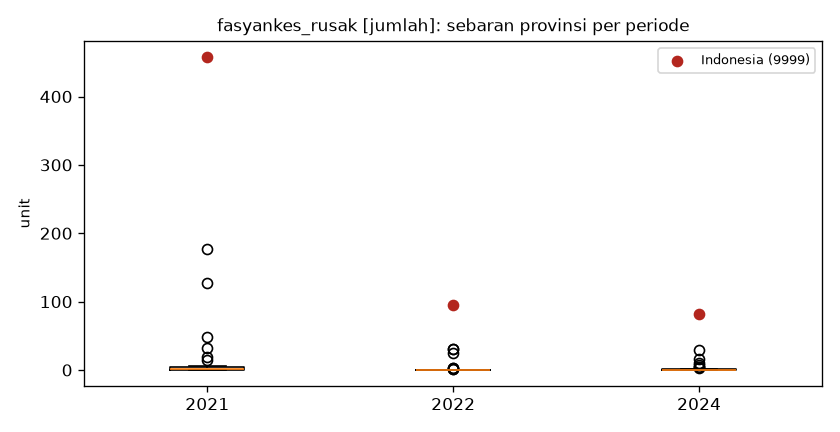
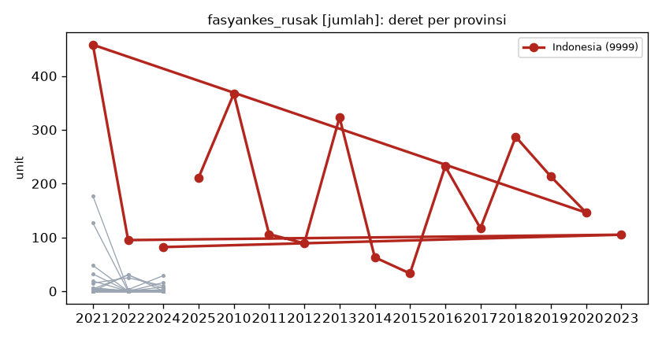
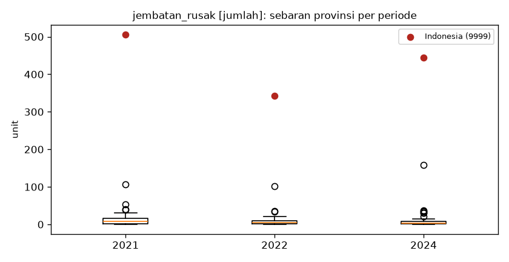
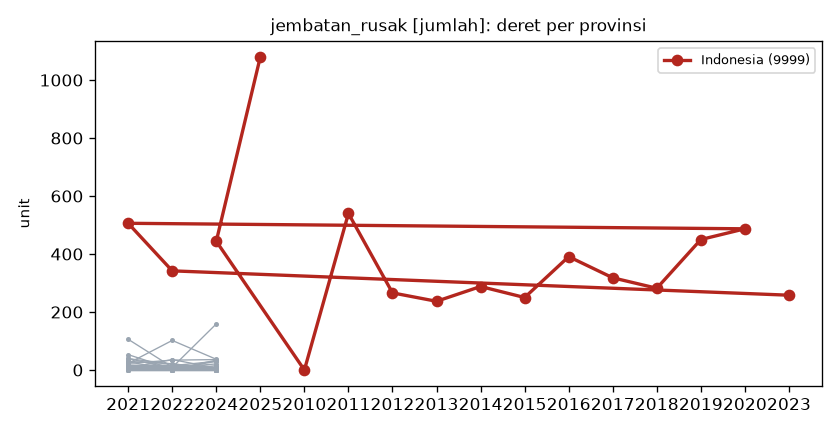
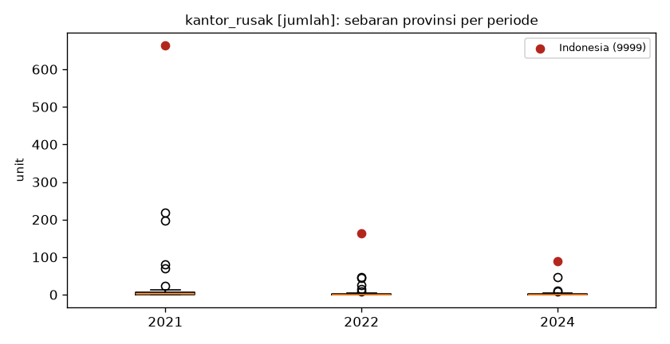
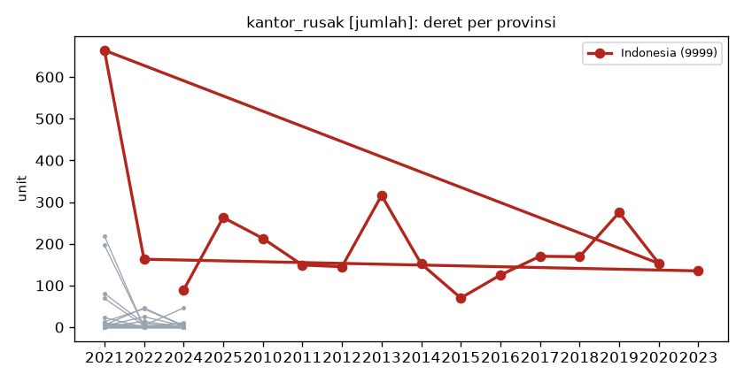
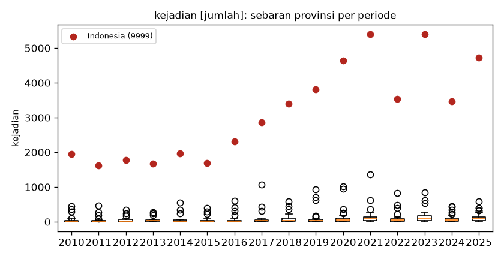
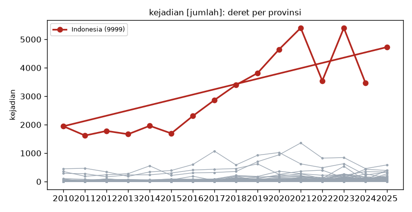
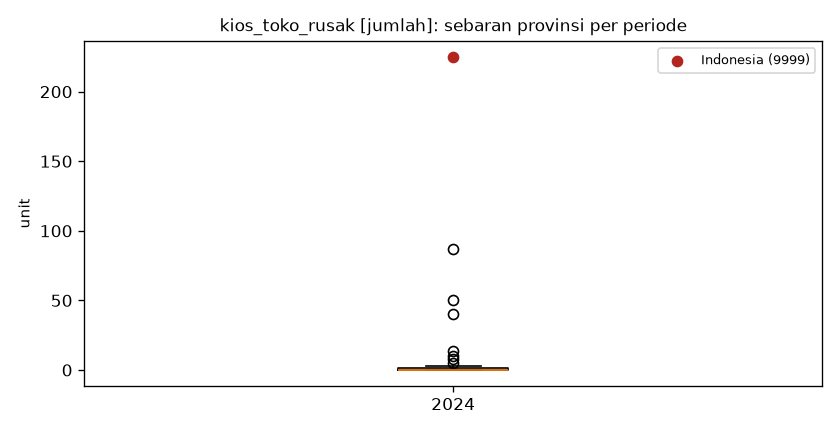
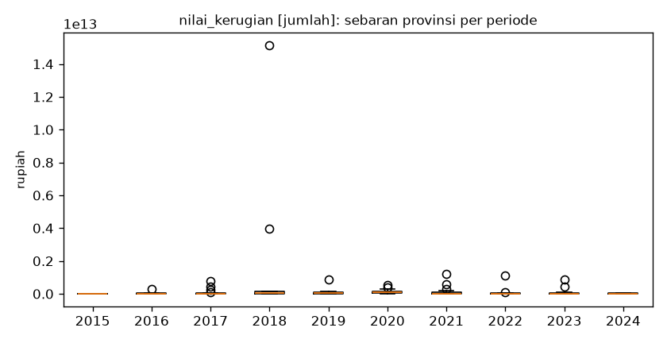
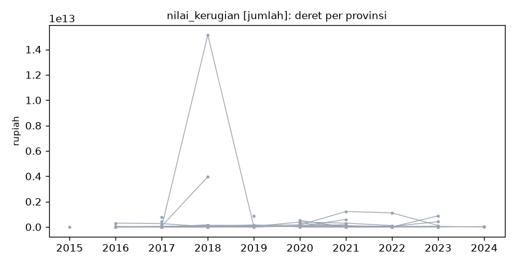
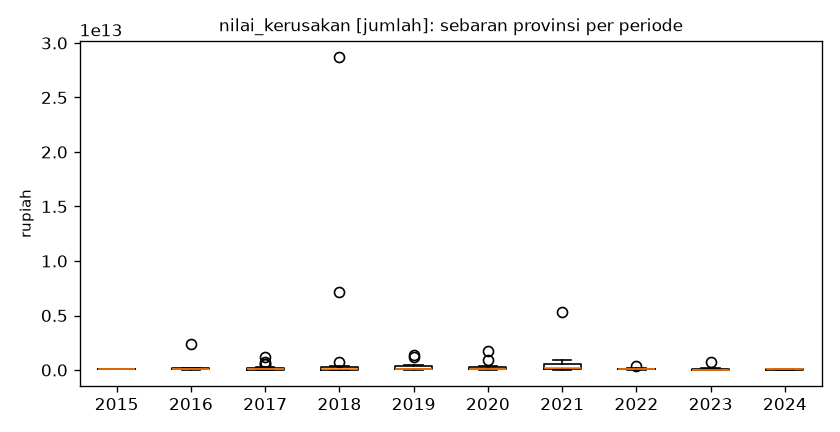
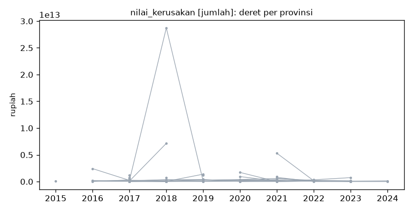
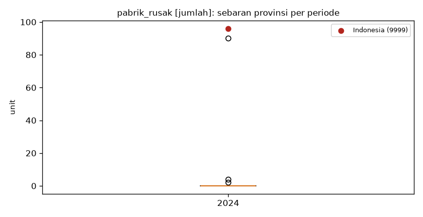
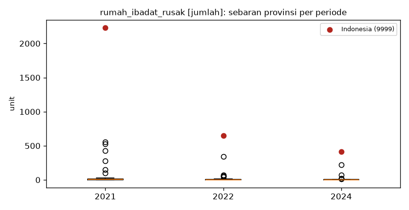
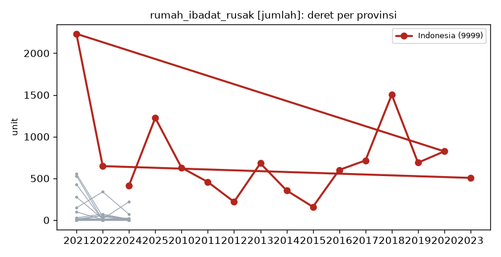
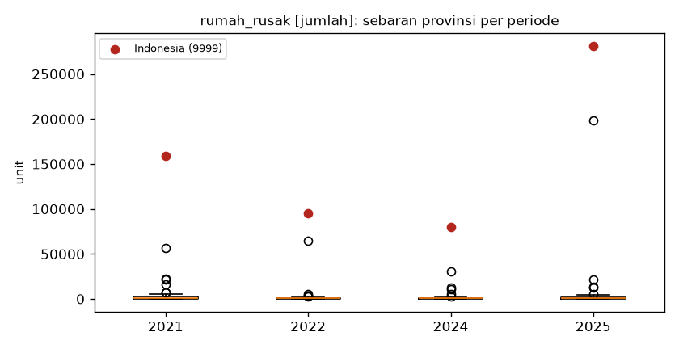
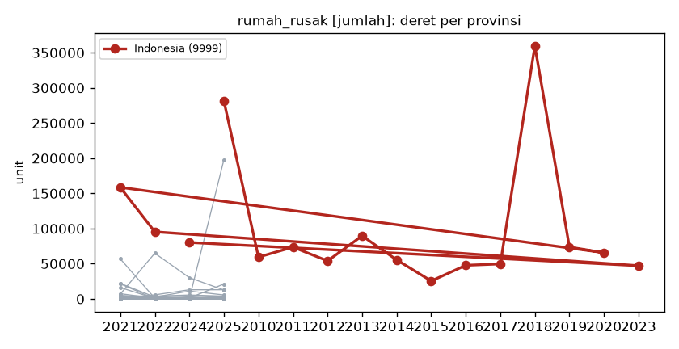
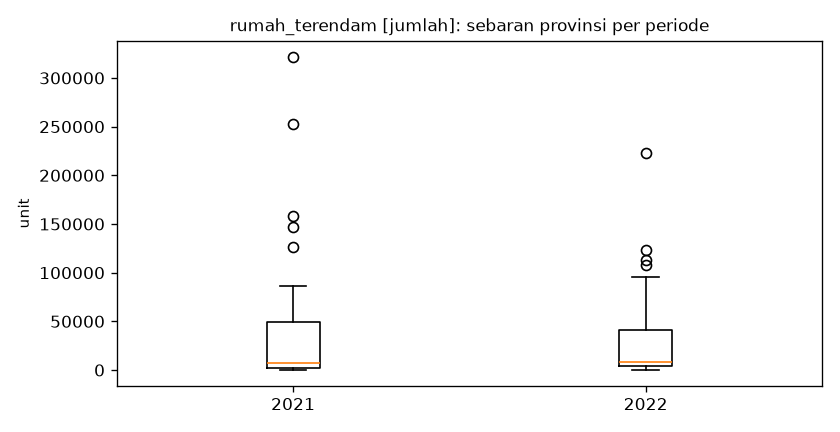
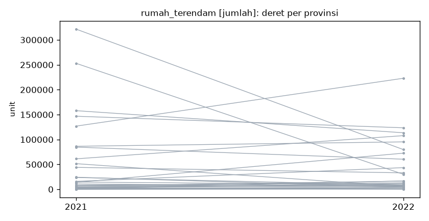
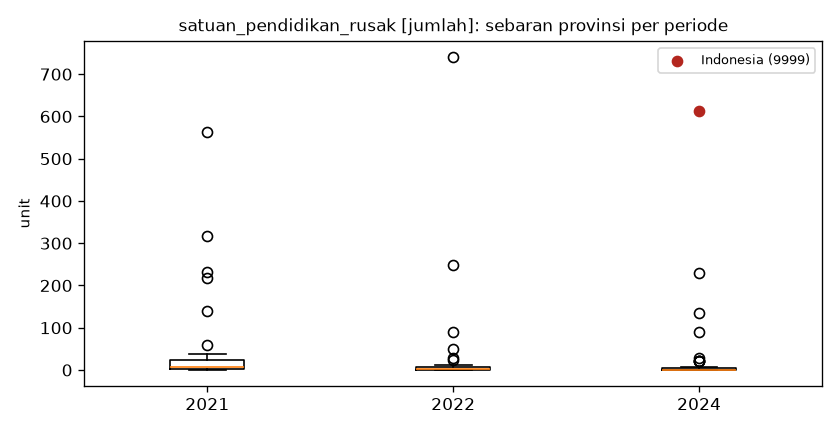
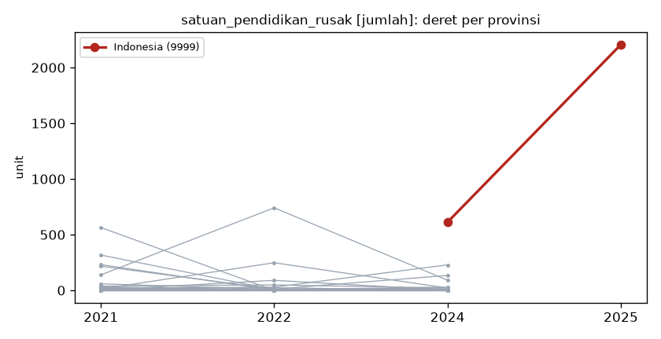
